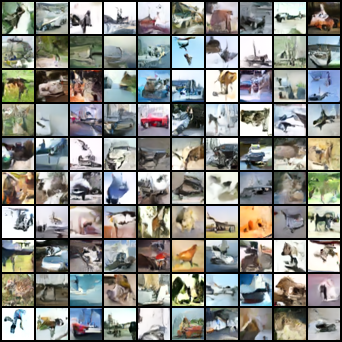
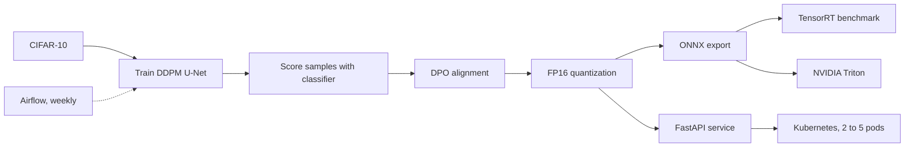
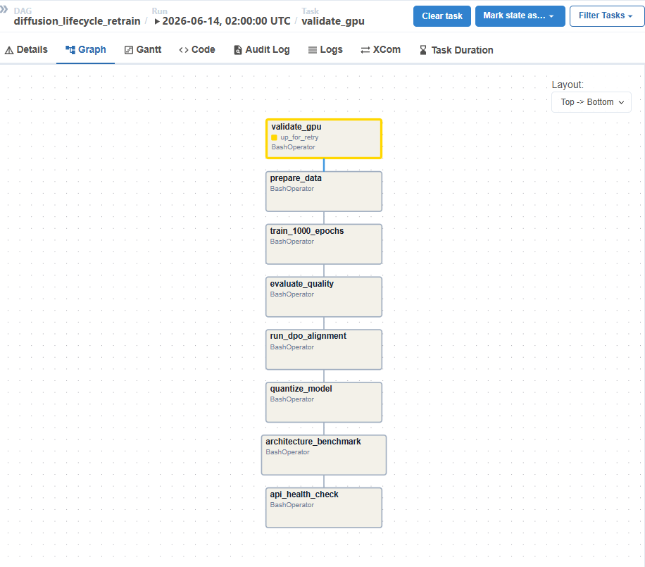

# Diffusion Model Lifecycle

[](https://github.com/Siddhesh-Ai9797/diffusion-lifecycle/actions/workflows/ci.yml)

A diffusion model built from scratch in PyTorch and taken all the way to production. It trains a DDPM on CIFAR-10, aligns it with DPO, speeds it up with torch.compile and TensorRT, and serves it through FastAPI and NVIDIA Triton on Kubernetes. An Airflow pipeline retrains it every week.

No diffusion or alignment libraries are used. The noise schedule, U-Net, sampler and DPO loss are all written by hand.

<p align="center"></p>

## Results

| Metric | Value |
|---|---|
| Fastest inference, TensorRT FP16 | 0.95s, **2.57x** faster than PyTorch |
| torch.compile, reduce-overhead | **2.07x** faster, **31%** less GPU memory |
| FP16 quantization | Model size 8.04 MB to 4.03 MB |
| API latency | p50 2.56s, p95 2.84s |
| Quality judge classifier | 77.7% accuracy on CIFAR-10 |

Benchmarks were run on an RTX 5060 Ti.

## How it works



1. **Train.** A 2.1M parameter U-Net learns to predict the noise added to CIFAR-10 images over a 1,000 step schedule. Training runs for 100 epochs, about 78,200 steps, and every run is tracked in MLflow.
2. **Judge.** A small CNN classifier scores each generated image. Its confidence works as a quality score.
3. **Align.** The 50 best and 50 worst images become preference pairs for DPO. The model learns to make the preferred images more likely while a frozen copy keeps it from drifting too far.
4. **Optimize.** The model is converted to FP16, compiled with torch.compile, and exported to ONNX and TensorRT.
5. **Serve.** FastAPI serves images with live latency, confidence and GPU memory metrics. Triton serves the ONNX model with dynamic batching up to 16 requests. Kubernetes runs 2 pods and scales to 5 when CPU passes 70%.
6. **Retrain.** An 8 task Airflow DAG runs every Sunday: check the GPU, prepare data, train, evaluate, run DPO, quantize, benchmark, and health check the API.



## Benchmarks

### Inference speed

| Mode | Time | Speedup |
|---|---|---|
| PyTorch eager | 2.43s | 1.00x |
| torch.compile, reduce-overhead | 1.16s | 2.07x |
| TensorRT FP32 | 0.96s | 2.53x |
| **TensorRT FP16** | **0.95s** | **2.57x** |

### torch.compile modes

| Mode | Time | Speedup | GPU memory |
|---|---|---|---|
| Eager | 2.41s | 1.00x | 53.8 MB |
| Default | 1.61s | 1.50x | 49.1 MB |
| **Reduce-overhead** | **1.16s** | **2.07x** | **36.9 MB** |
| Max-autotune | 1.16s | 2.07x | 44.9 MB |

### U-Net architectures, 30 epochs each

| Architecture | Params | Epoch time | Loss | Confidence | Samples |
|---|---|---|---|---|---|
| Baseline CNN | 2.10M | 22.5s | 0.050 | 0.496 | Dark, collapsed |
| Self-attention | 2.17M | 22.8s | 0.044 | 0.543 | Good |
| **Linear attention** | **2.17M** | **23.4s** | **0.011** | **0.552** | **Best** |
| Mamba style SSM | 2.17M | 67.2s | 0.020 | 0.575 | Richest colors |

### Quantization

| Precision | Size | Time | Confidence |
|---|---|---|---|
| FP32 | 8.04 MB | 2.82s | 0.664 |
| **FP16** | **4.03 MB** | **2.60s** | 0.632 |

### Triton load test

`scripts/triton_perf.sh` runs NVIDIA perf_analyzer against Triton and raises concurrency from 1 to 16 so dynamic batching can group requests. It saves throughput and p50, p95 and p99 latency to `outputs/triton_perf.csv`.

## What I learned

**DPO can collapse a model.** My first DPO run used a learning rate of 1e-4, 30 epochs and beta 0.1. Every image turned into a solid color, because the mean pixel value drifted from about 0 to about 1. I found it by comparing checkpoints before and after DPO, in FP32 and FP16. A stronger anchor to the reference model, beta 1.0, and a gentler learning rate, 1e-5, fixed it.

**Mamba needs custom CUDA kernels.** The SSM block gave the best looking images but trained 3x slower. Its scan runs as a Python loop, one step at a time. Real Mamba uses a parallel scan written in CUDA, which is why hardware aware kernels matter for these models.

**torch.compile saves memory, not just time.** Reduce-overhead mode fused many small operations into fewer CUDA kernels. That removed temporary tensors and cut GPU memory by 31%.

## Tech stack

| Area | Tools |
|---|---|
| Modeling | PyTorch, CUDA 12.8 |
| Optimization | TensorRT, ONNX, torch.compile, FP16 |
| Serving | FastAPI, NVIDIA Triton Inference Server |
| MLOps | Docker, Kubernetes with autoscaling, Airflow, MLflow, GitHub Actions |

## Project structure

```
src/
  noise_schedule.py          Forward diffusion and beta schedule
  unet.py                    Baseline U-Net, 2.1M parameters
  unet_attention.py          U-Net with self-attention
  unet_linear_attention.py   U-Net with linear attention
  unet_mamba.py              U-Net with a Mamba style SSM block
  train.py                   Training loop with MLflow
  sample.py                  Reverse process to generate images
  classifier.py              Quality judge CNN
  score_samples.py           Generate and score images for DPO
  dpo.py                     DPO alignment
  quantize.py                FP32 vs FP16 benchmark
  benchmark.py               Architecture comparison
  compile_benchmark.py       torch.compile benchmark
  tensorrt_benchmark.py      TensorRT benchmark
  export_onnx_triton.py      ONNX export for Triton
  serve.py                   FastAPI service with metrics
triton_models/               Triton model repository and config
k8s/                         Deployment, service and autoscaler
airflow/dags/                Weekly retraining DAG
scripts/triton_perf.sh       Triton load test
tests/                       Unit, API and Triton contract tests
```

## Running it

**Docker**

```bash
docker build -t diffusion-api .
docker run --gpus all -p 8000:8000 diffusion-api
curl -X POST "http://localhost:8000/generate?num_images=4" --output samples.png
curl http://localhost:8000/metrics
```

**Locally**

```bash
pip install -r requirements.txt
python -m src.train
python -m src.dpo
python -m src.quantize
uvicorn src.serve:app
```

**Triton**

```bash
docker compose -f docker-compose-triton.yml up -d
bash scripts/triton_perf.sh
```

**Kubernetes**

```bash
kubectl apply -f k8s/
```

**Airflow**

```bash
docker compose -f docker-compose-airflow.yml up
```

Then open http://localhost:8080 and trigger the `diffusion_lifecycle_retrain` DAG.

## Tests

```bash
pip install torch torchvision --index-url https://download.pytorch.org/whl/cpu
pip install fastapi httpx mlflow onnx onnxruntime pytest
python -m pytest -q
```

The tests cover the noise schedule, all four U-Net versions and the API. They also check the Triton setup: the ONNX input and output names match `config.pbtxt`, the batch size is dynamic, and the ONNX model gives the same output as the PyTorch weights. GitHub Actions runs them on every push.

## Author

Siddhesh Patil, MS in Artificial Intelligence, DePaul University
